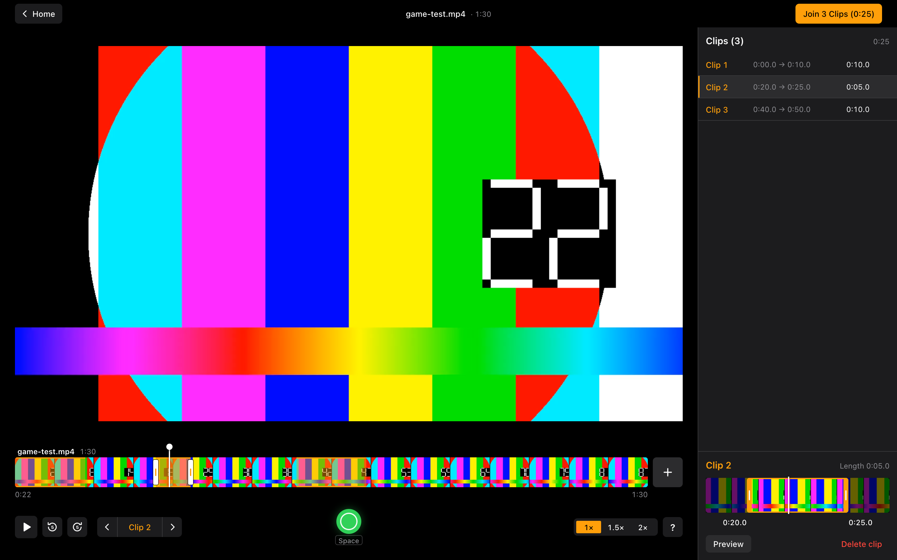

# VBClipper Web

Browser version of the VBClipper iOS app. Load one or more volleyball recordings, mark where each
point starts and ends, and keep the marked clips. Everything runs in the browser; the videos are
never uploaded or read into memory. See [SPEC.md](SPEC.md) for the full product spec.

The editor (phase 1) marks the clips; Join (phase 2) renders them into one mp4 in the browser with
ffmpeg.wasm; the timeline (phase 3) shows a filmstrip and lets one session span several videos.

## Setup

Requires Node and pnpm.

```bash
pnpm install
pnpm dev
```

Then open the URL Vite prints (usually http://localhost:5173).

| Script        | What it does                             |
| ------------- | ---------------------------------------- |
| `pnpm dev`    | Start the dev server                     |
| `pnpm build`  | Type-check and build to `dist/`          |
| `pnpm test`   | Run the Vitest unit tests for `src/lib/` |
| `pnpm lint`   | Run ESLint                               |
| `pnpm format` | Format with Prettier                     |

## Using it

1. Choose Video (or drop a video file on the page). MP4 (H.264) and WebM play in all modern
   browsers. MOV plays in Chrome and Safari.
2. To add more recordings of the same match (a second camera, the next set), click the plus tile
   at the right end of the timeline or drop the files anywhere on the editor. They play back to
   back in timeline order; drag a video's name to reorder.
3. Press Space when a point starts and again when it ends. Each pair saves a clip. A clip stays
   inside one video: ending it in a different video shows "A clip can't span two videos".
4. Review and fix clips in the sidebar, then use Join in the top bar to render one video.

The session saves to `localStorage` as you go. Browsers cannot reopen a file on their own, so
Continue Session asks you to pick the same video files again (several at once is fine). If some
are still missing, the card lists them: pick them, or Open without them to drop those videos and
their clips. Sessions saved by earlier versions open as a single-video session.

## The editor

The editor is a desktop layout built for mouse and keyboard; it fills the window and never
scrolls (only the clip list does). The minimum supported width is 1024px; below that the clips
sidebar becomes an overlay behind a toggle in the top bar. It is styled like a desktop editing
tool: 13px type, 32px square-cornered controls, dense 36px clip rows, and tooltips that show
each control's key as a chip.

- Top bar: Home (saves and goes back), the file name and duration (or "3 videos · 1:52:10" with
  several), and Join (see Joining clips below; disabled until there is a clip).
- Video: click to play or pause. A badge in the top-left shows the speed when it is above 1×.
  At the end of one video playback continues with the next.
- Timeline: one block per video, sized by its share of the total length, each with a filmstrip
  of preview frames that fills in as they are read. Hover for the time, click to seek, drag the
  playhead to scrub. Click a clip band to select it; the selected clip shows two handles you drag
  to trim its start or end, and the video follows the handle so you can see the frame. Drag a
  block's header to reorder the videos (Esc cancels); hover a header for its × to remove that
  video and its clips (Undo brings them back). The plus tile adds videos; one that is already in
  the timeline is skipped.
- Transport bar: play/pause, back and forward 5 s, previous / current / next clip, the mark
  button (Space), the 1× / 1.5× / 2× speed control, and the shortcuts list. Hover any button to
  see its key.
- Clips sidebar: click a row to select it and jump to its start, double-click to play just that
  clip, hover for the delete icon. Clips are listed in timeline order, then by start time. An
  amber dot marks clips that overlap another clip of the same video. The selected clip's editor is
  pinned at the bottom with a trim strip, Preview and Delete clip.
- Trim strip: a zoomed filmstrip of the clip with a few seconds either side. Drag the orange
  handles to move the start or end (about 20 ms per pixel, the fine adjustment); the start and end
  times under the handles update as you drag, and releasing is one undo step. Esc during a drag
  puts the clip back. Click anywhere else on the strip to seek there.

## Joining clips

Join renders the marked clips back to back, in timeline order, into
`<first video name>-highlights.mp4`, which downloads automatically (Save again downloads it once
more until you close the dialog). Overlapping clips of the same video are merged first, so shared
footage appears once. Everything runs in the browser with ffmpeg.wasm; each source file is mounted
read-only, never uploaded or copied into memory.

- Fast (default) stream-copies each clip and then concatenates them. It takes seconds, but cuts
  can only land on keyframes, so a clip may start up to one keyframe interval early (usually
  under a second on phone recordings).
- Precise re-encodes each clip with H.264/AAC, so cuts are frame-accurate. It is much slower in
  the browser; the mode card shows an estimate at the speed this browser managed last time.

While a join runs, one bar covers the whole job: downloading ffmpeg (about 33 MB, only the first
time in a page, with the bytes shown), cutting each clip, combining them and saving. Each part
takes its share of the bar by how long it is expected to take, so the percent tracks real work
and never moves backwards (except once, if Fast has to switch to Precise). The time left comes
from the speed measured during the run, smoothed so it does not flicker, and reads "Estimating…"
for the first few seconds. The measured speeds (download, Fast, Precise and combining) are kept
in `localStorage` under `vbclipper:join-rates`, so the next join starts from them.

Opening videos shows progress too: Choose Video and Continue Session read "Opening <name>…" (or
"Opening 2 of 3…") while each file's length is read, the plus tile spins while added videos are
read, and a block header shows "Preparing frames 12/25" with a thin line until its filmstrip is
complete.

If Fast cannot combine the clips (usually because their codec settings differ, as with videos
from different cameras), the join switches to Precise on its own and says why. The joined file is assembled in browser memory, so Join refuses
selections whose output would exceed about 1.5 GB.

### Hosting

ffmpeg's multi-thread core needs `SharedArrayBuffer`, which browsers only allow on cross-origin
isolated pages. `pnpm dev` and `pnpm preview` already send the two headers; a static host serving
`dist/` must send them on every response too:

```
Cross-Origin-Opener-Policy: same-origin
Cross-Origin-Embedder-Policy: require-corp
```

Without them the app falls back to the single-thread core, which works everywhere but is slower,
especially in Precise mode. The core's `.js`, `.wasm` and worker files are bundled as separate
assets in `dist/assets/`, so the app never loads them from a CDN and works offline.

## Keyboard shortcuts

| Key                          | Action                                               |
| ---------------------------- | ---------------------------------------------------- |
| Space                        | Mark start / mark end                                |
| K or click video             | Play / pause                                         |
| Double-click clip row        | Play that clip only                                  |
| ← / →                        | Seek −5 s / +5 s                                     |
| ↑ / ↓ or [ / ]               | Previous / next clip                                 |
| S                            | Cycle sticky speed 1× / 1.5× / 2×                    |
| E                            | Edit selected clip                                   |
| Delete / Backspace           | Delete selected clip                                 |
| Cmd/Ctrl+Z, Shift+Cmd/Ctrl+Z | Undo / redo                                          |
| Esc                          | Cancel open marker, close dialog, else deselect clip |
| ?                            | Show shortcuts                                       |

Shortcuts are ignored while focus is in a text input.



## Layout

- `src/lib/`: pure clip math, sequence time across sources, navigation rules, timeline
  hit-testing and trim math, the trim strip window, filmstrip tile layout, the session reducer,
  persistence, and the join plan and runner in `src/lib/join/`. Unit tested.
- `src/media/`: reading a file's duration, the editor's files and object URLs, and the in-memory
  thumbnail cache that both filmstrips draw from.
- `src/join/ffmpeg.ts`: the `@ffmpeg/ffmpeg` adapter the join runner uses in the browser.
- `src/hooks/`: the video player that plays the sources back to back, keyboard shortcuts,
  persistence, toasts, routing.
- `src/screens/`: Home and Editor screens, with the editor's timeline, transport bar, clip list,
  clip editor and Join dialog in `src/screens/editor/`; `src/components/`: shared UI (buttons,
  tooltips and key chips in `ui.module.css`, the `Tip` tooltip, dialogs, toasts). Design tokens
  (type scale, radii, control heights, colors) live in `src/index.css`.
